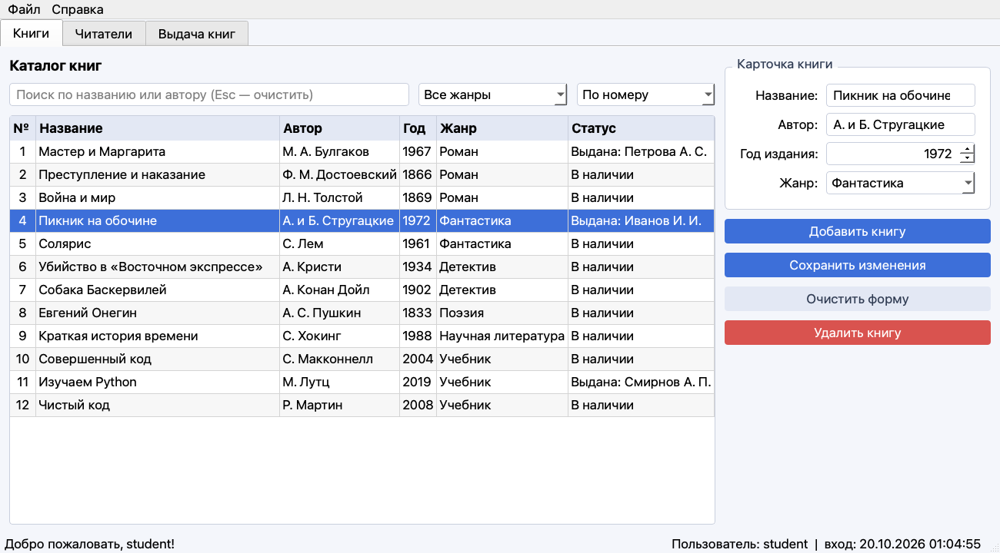
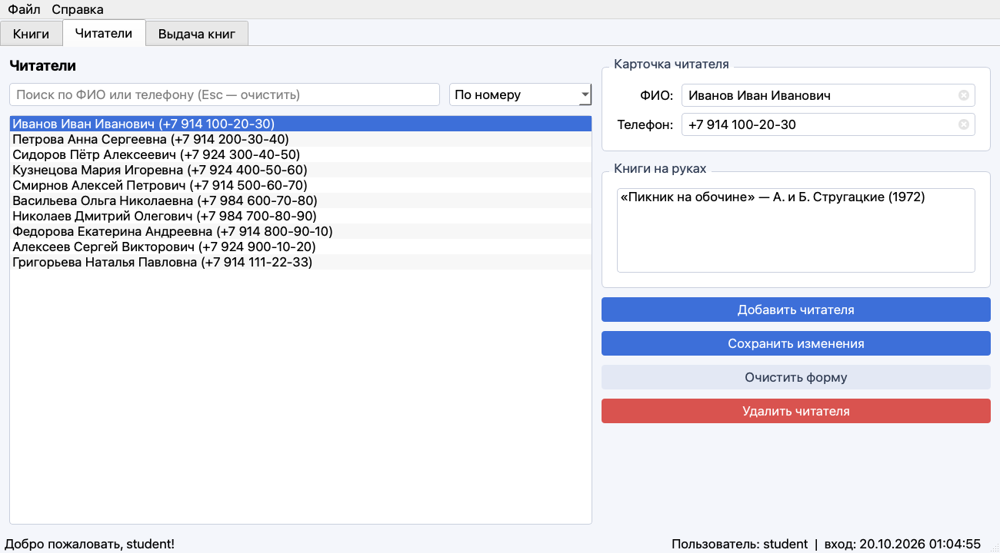
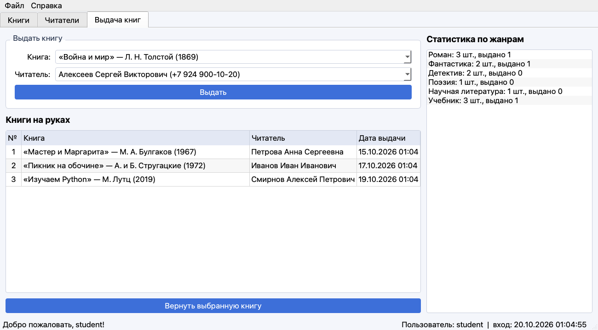

# Библиотека 

Проект по ООП: учёт книг и читателей, выдача и возврат книг.

## Скриншоты

Каталог книг:



Читатели и книги у них на руках:



Выдача книг и статистика по жанрам:



## Отчёт

При закрытии программы в `report.txt` сохраняется сеанс работы:

```
+-----------------------------------------------------+
| login   | time_in             | time_out            |
|---------|---------------------|---------------------|
| student | 14.10.2026 10:00:00 | 14.10.2026 10:05:00 |
+-----------------------------------------------------+
```

